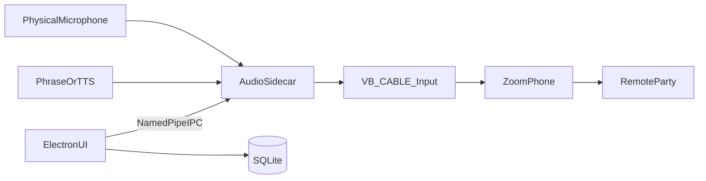

# Zoom Dialer Companion — Project Documentation

## Purpose

This documentation set is the authoritative specification and implementation roadmap for **Zoom Dialer Companion**, a Windows desktop application that plays prerecorded audio clips or local text-to-speech into an active Zoom Phone call by mixing microphone and playback audio through a virtual microphone. It never modifies Zoom Phone and never uses undocumented Zoom APIs.

## Scope

- Planning and architecture only (this phase).
- Production-grade specification covering Electron UI, Node orchestration, .NET 8 audio sidecar, virtual audio routing, storage, security, testing, packaging, and release.
- Atomic, checkbox-driven tasks sized for one small Git commit each.
- Out of scope for this phase: any source code, TypeScript/JavaScript/C#/C++ files, or configuration files.

## Dependencies

| Dependency | Role |
|---|---|
| Windows 11 | Target OS and WASAPI host |
| Electron + React + TypeScript | Desktop shell and UI |
| Node.js (Electron main) | Orchestration, persistence, IPC bridge |
| .NET 8 + NAudio | Real-time audio sidecar |
| Named pipes | Versioned IPC between Electron and sidecar |
| VB-CABLE | Virtual microphone endpoint (initial) |
| VoiceMeeter (optional) | Advanced routing alternative |
| SQLite | Phrase metadata and FTS search |
| Windows SAPI | Local TTS backend |
| Zoom Phone desktop | External consumer of virtual mic (unchanged) |
| electron-builder / NSIS | Installer packaging |
| electron-updater | Auto-update channel |

## Deliverables

| Document | Description |
|---|---|
| [architecture.md](architecture.md) | Complete system architecture, IPC, threads, state, Mermaid diagrams |
| [backend.md](backend.md) | Node/.NET orchestration and service task checklist |
| [electron.md](electron.md) | Electron/React UI task checklist |
| [audio-engine.md](audio-engine.md) | WASAPI capture, mix, render, latency, ducking checklist |
| [virtual-audio.md](virtual-audio.md) | VB-CABLE, device discovery, routing, recovery checklist |
| [storage.md](storage.md) | SQLite, assets, import/export, backup checklist |
| [testing.md](testing.md) | Unit, integration, latency, stress, compatibility checklist |
| [security.md](security.md) | Permissions, validation, path safety, logging security |
| [ui-ux.md](ui-ux.md) | Layouts, flows, keyboard-first UX, a11y, themes |
| [features.md](features.md) | Master feature → subfeature → atomic task tracker |
| [project-plan.md](project-plan.md) | Phased roadmap from planning to production |
| [risks.md](risks.md) | Risk register with probability, impact, mitigation |
| [decisions.md](decisions.md) | Architecture Decision Records (ADRs) |

## Completion Criteria

* [x] All fourteen documentation files exist under `docs/`
* [x] Every file includes Purpose, Scope, Dependencies, Deliverables, Completion Criteria
* [x] Implementation work is expressed as granular `* [ ]` checkboxes
* [x] Architecture diagrams use valid Mermaid syntax
* [x] Task IDs are stable and cross-referenced between `features.md` and `project-plan.md`
* [x] No source or configuration files are created in this phase
* [x] Documentation alone is sufficient to implement the product one commit at a time

---

## Project Overview

Zoom Dialer Companion sits beside Zoom Phone. The user places calls with Zoom Phone as usual. During a call, a keyboard shortcut or UI button triggers playback of a library phrase (MP3/WAV) or local TTS. The companion captures the physical microphone, mixes it with the playback stream in real time, and outputs the mix to a virtual microphone (VB-CABLE). Zoom Phone is configured to use that virtual microphone, so the remote party hears both live speech and the clip simultaneously.



## Goals

1. Instant, low-latency phrase playback into live Zoom Phone calls.
2. Simultaneous live microphone speech and clip audio (true mix, not mute-and-play).
3. Zero Zoom Phone modification; zero undocumented Zoom APIs.
4. Windows-audio-stack-only solution via virtual microphone.
5. Searchable, categorized phrase library with import/export.
6. Keyboard-first operator workflow.
7. Production packaging: installer, auto-update, logging, error handling, tests.

## Non-Goals

- Replacing Zoom Phone softphone functionality.
- Cloud TTS or cloud phrase sync in v1.
- macOS / Linux support in v1.
- Custom kernel-mode audio drivers in v1.
- Undocumented Zoom hooks, overlays inside Zoom, or DLL injection.

## Architecture Overview

| Layer | Technology | Responsibility |
|---|---|---|
| Renderer | React + TypeScript | Phrase library UI, settings, shortcuts display |
| Main process | Electron + Node.js | Window lifecycle, secure IPC, settings, DB, sidecar process manager |
| Audio sidecar | .NET 8 + NAudio | WASAPI capture/render, SRC, mix, ducking, fades, TTS |
| Transport | Named pipes (versioned JSON framing) | Command/event channel between main and sidecar |
| Persistence | SQLite + filesystem assets | Phrases, categories, FTS, audio files |
| Virtual device | VB-CABLE (VoiceMeeter optional) | Virtual recording endpoint for Zoom Phone |

See [architecture.md](architecture.md) for full detail and [decisions.md](decisions.md) for ADRs.

## Proposed Repository Folder Structure

```text
Zoom-Dialer/
├── docs/                         # This documentation set
├── apps/
│   ├── desktop/                  # Electron + React + TypeScript
│   │   ├── src/
│   │   │   ├── main/             # Electron main process
│   │   │   ├── preload/          # Context-isolated preload bridge
│   │   │   └── renderer/         # React UI
│   │   └── ...
│   └── audio-sidecar/            # .NET 8 NAudio service
│       ├── AudioEngine/
│       ├── Devices/
│       ├── Playback/
│       ├── Tts/
│       ├── Ipc/
│       └── ...
├── packages/
│   ├── shared-protocol/          # IPC message schemas (TS + mirrored C#)
│   └── shared-types/             # Shared domain types for UI/main
├── assets/                       # Bundled sample phrases (optional)
├── scripts/                      # Build, package, sign helpers
├── installer/                    # electron-builder / NSIS config (later phase)
├── tests/
│   ├── unit/
│   ├── integration/
│   └── manual/
└── README.md                     # Root readme (later phase)
```

> Folder structure above is planning guidance only. No folders outside `docs/` are created in this phase.

## Development Phases (Summary)

| Phase | Name | Focus |
|---|---|---|
| 0 | Planning | This documentation set |
| 1 | Foundations | Repo scaffold, shared protocol, logging, CI skeleton |
| 2 | Core Audio | WASAPI capture, mix, render to VB-CABLE |
| 3 | Playback | MP3/WAV decode, fades, ducking, volume |
| 4 | Virtual Audio Ops | Device discovery, switching, recovery |
| 5 | Electron Shell | Main/preload/renderer, secure IPC |
| 6 | Phrase Library | SQLite, categories, search, CRUD |
| 7 | TTS | Local SAPI TTS into mix pipeline |
| 8 | Shortcuts & UX | Global hotkeys, keyboard-first flows |
| 9 | Settings & Logging | Preferences, diagnostics, error surfaces |
| 10 | Import/Export | Phrase packs, backup/restore |
| 11 | Hardening | Security, stress, leak, latency gates |
| 12 | Packaging | Installer, code signing, auto-update |
| 13 | Release | Beta → GA → post-release ops |

Full phased checklists live in [project-plan.md](project-plan.md).

## Build Order

Recommended implementation order (dependency-safe):

1. Shared IPC protocol definitions (schemas only).
2. Audio sidecar skeleton + device enumeration.
3. Microphone capture → pass-through → VB-CABLE render.
4. PCM mixer + clip playback injection.
5. Ducking, fades, volume, SRC, buffer tuning.
6. Electron main process manager for sidecar lifecycle.
7. Preload bridge + React shell.
8. SQLite phrase store + FTS.
9. UI phrase management + search + categories.
10. Global shortcuts → play command.
11. Local TTS path.
12. Settings, logging, error handling.
13. Import/export + backup.
14. Test suite expansion + latency measurement harness.
15. Installer + auto-update + release checklist.

## Milestones

| Milestone | Exit Gate |
|---|---|
| M0 Spec Complete | All `docs/` files accepted |
| M1 Pass-Through Audio | Mic → mix → VB-CABLE audible in Zoom Phone |
| M2 Clip Into Call | Hotkey plays WAV into active call with live mic |
| M3 Library MVP | CRUD phrases, categories, search, MP3+WAV |
| M4 Operator Ready | Shortcuts, ducking, volume, settings, TTS |
| M5 Hardened Beta | Security + stress + latency SLOs met |
| M6 GA | Signed installer, auto-update, docs, support runbook |

## Principal Risks

| Risk | Impact | Mitigation (summary) |
|---|---|---|
| Zoom AGC / noise suppression attenuates clips | High | Document Zoom mic settings; ducking/normalization controls |
| VB-CABLE missing or misconfigured | High | Setup wizard; device health checks; clear recovery UX |
| Sample-rate mismatch / glitches | High | Explicit SRC; exclusive/shared mode policy; buffer sizing |
| Sidecar crash during call | High | Auto-restart; fail-open to pass-through or safe mute policy |
| Global hotkey conflicts | Medium | Configurable chords; conflict detection |
| Latency spikes under CPU load | High | Real-time thread priority; buffer budgets; telemetry |
| Race conditions in mix/play | High | Lock-free ring buffers; single audio clock; state machine |

Full register: [risks.md](risks.md).

## How to Use This Documentation

1. Read [architecture.md](architecture.md) and [decisions.md](decisions.md) first.
2. Track day-to-day work in [features.md](features.md) (canonical checkbox source).
3. Follow phase order in [project-plan.md](project-plan.md).
4. Drill into domain docs (`audio-engine.md`, `virtual-audio.md`, etc.) when implementing those areas.
5. One checkbox → one focused Git commit whenever practical.

## Document Status

| File | Status |
|---|---|
| README.md | Authoritative hub |
| architecture.md | Authoritative |
| backend.md | Authoritative checklist |
| electron.md | Authoritative checklist |
| audio-engine.md | Authoritative checklist |
| virtual-audio.md | Authoritative checklist |
| storage.md | Authoritative checklist |
| testing.md | Authoritative checklist |
| security.md | Authoritative checklist |
| ui-ux.md | Authoritative checklist |
| features.md | Master tracker |
| project-plan.md | Master roadmap |
| risks.md | Risk register |
| decisions.md | ADR log |
