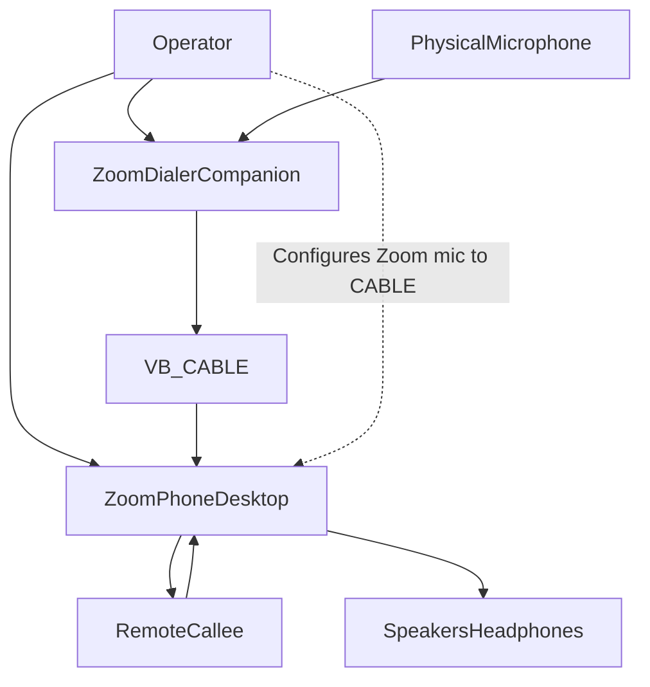
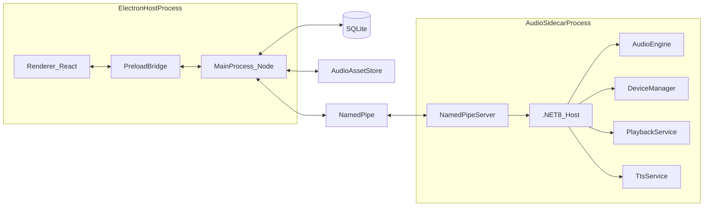
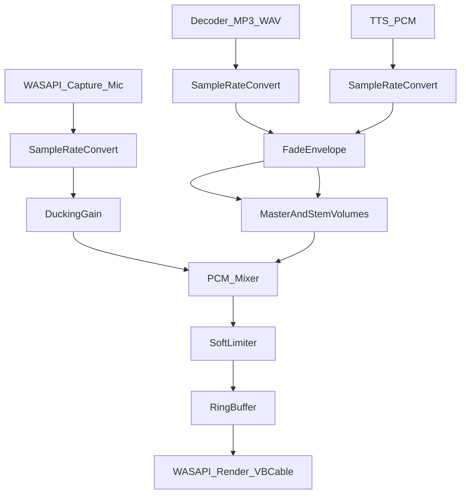
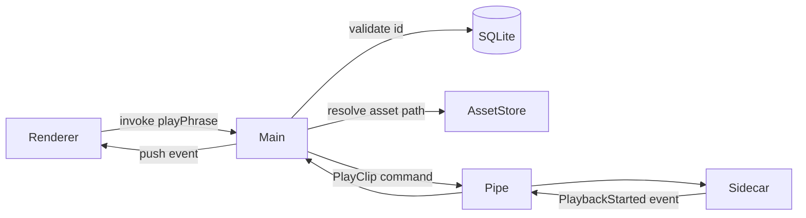
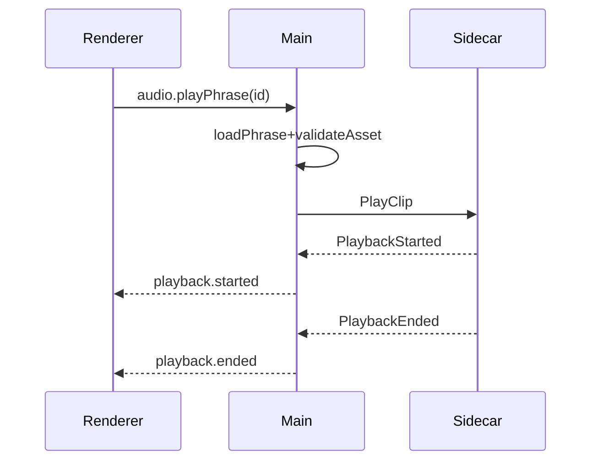
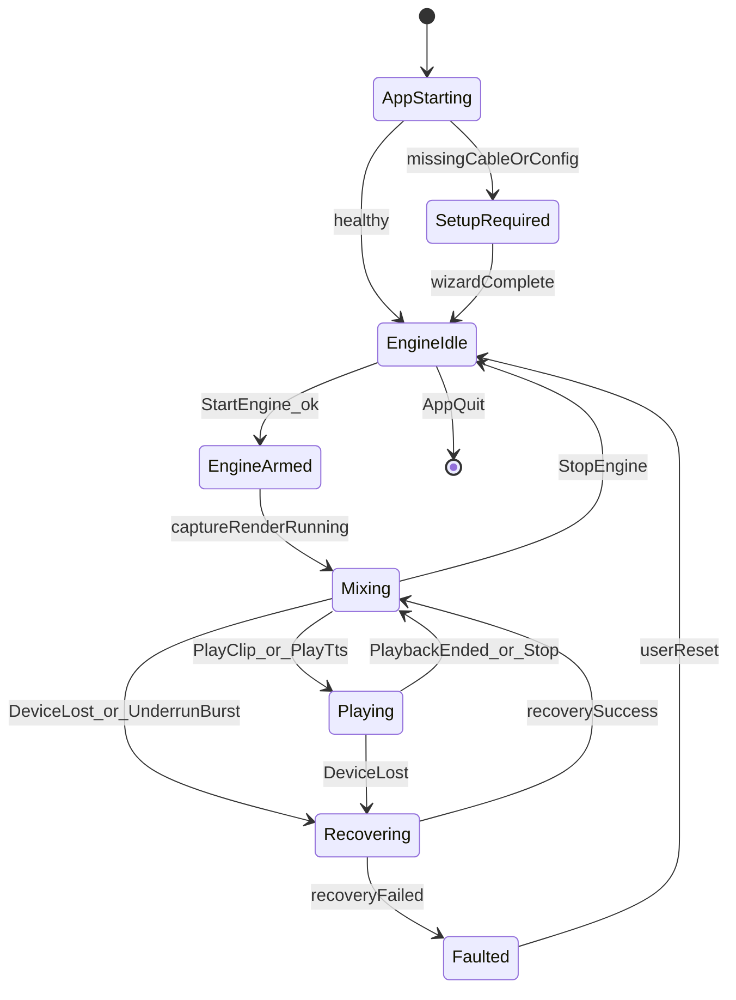
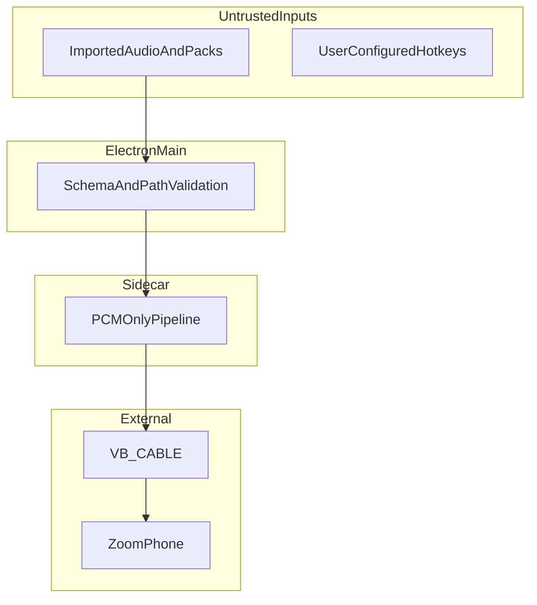

# Architecture

## Purpose

Define the complete system architecture for Zoom Dialer Companion: processes, components, data and audio flows, IPC, events, threading, state management, and module responsibilities. This document is the technical source of truth for implementers.

## Scope

- In scope: Windows 11 desktop companion architecture; Electron + React + TypeScript; Node main orchestration; .NET 8 NAudio sidecar; named-pipe IPC; SQLite; VB-CABLE; local SAPI TTS.
- Out of scope: Zoom Phone internals, cloud sync, non-Windows platforms, custom kernel drivers.

## Dependencies

- [README.md](README.md) — project goals and phase map
- [decisions.md](decisions.md) — ADRs that justify this architecture
- [audio-engine.md](audio-engine.md) — detailed audio pipeline tasks
- [virtual-audio.md](virtual-audio.md) — device routing tasks
- [backend.md](backend.md) / [electron.md](electron.md) — implementation checklists

## Deliverables

- Component and process model
- Audio and data flow diagrams (Mermaid)
- IPC contract outline
- Thread model and state machines
- Module responsibility matrix

## Completion Criteria

* [x] Architecture covers all production capabilities listed in the project goal
* [x] Mermaid diagrams render without syntax errors
* [x] Process boundaries and trust boundaries are explicit
* [x] Thread and buffer model is implementable without further invention
* [x] Module owners map 1:1 to future source folders

---

## 1. System Context

**Invariant:** Zoom Phone is an opaque consumer of a Windows recording endpoint. The companion never injects into Zoom’s process.

---

## 2. Process Architecture

| Process | Language | Lifetime | Privilege |
|---|---|---|---|
| Electron main | Node/TS | App session | User |
| Electron renderer | React/TS | Window lifetime | Sandboxed |
| Audio sidecar | C# /.NET 8 | Managed by main; may outlive brief UI restarts | User |
| Zoom Phone | External | Independent | User |

---

## 3. Components

### 3.1 Electron Main (`apps/desktop/src/main`)

| Module | Responsibility |
|---|---|
| `AppBootstrap` | Single-instance lock, ready hooks, quit sequencing |
| `WindowManager` | BrowserWindow create/restore/minimize-to-tray |
| `IpcHost` | `ipcMain` handlers; validates renderer requests |
| `SidecarManager` | Spawn/monitor/restart sidecar; health pings |
| `PipeClient` | Named-pipe client; framing; timeouts; reconnect |
| `PhraseService` | CRUD over SQLite + asset files |
| `CategoryService` | Category tree operations |
| `SearchService` | FTS queries |
| `SettingsService` | Persisted user preferences |
| `ShortcutService` | Global and in-app accelerators |
| `ImportExportService` | Phrase pack zip/json |
| `UpdateService` | electron-updater integration |
| `LogService` | Structured logs, rotation |
| `DiagnosticsService` | Device report, latency samples export |

### 3.2 Preload (`apps/desktop/src/preload`)

| Module | Responsibility |
|---|---|
| `api` | `contextBridge.exposeInMainWorld` narrow surface |
| Channel allowlist | Exact method names; no Node/fs exposure |

### 3.3 Renderer (`apps/desktop/src/renderer`)

| Module | Responsibility |
|---|---|
| `AppShell` | Layout, routes, theme |
| `PhraseLibrary` | Search, categories, list, detail |
| `PlayerControls` | Play/stop/volume/duck indicators |
| `SettingsViews` | Devices, shortcuts, audio, updates |
| `SetupWizard` | First-run VB-CABLE + Zoom guidance |
| `ToastsDialogs` | Errors, confirms, loading |
| Store | UI state (Zustand/Redux Toolkit — see ADR) |

### 3.4 Audio Sidecar (`apps/audio-sidecar`)

| Module | Responsibility |
|---|---|
| `Program` / Host | DI, lifecycle, graceful shutdown |
| `IpcServer` | Accept pipe; deserialize commands; emit events |
| `DeviceManager` | Enumerate WASAPI devices; watch defaults; select |
| `CaptureGraph` | Mic WASAPI capture client |
| `RenderGraph` | Virtual mic WASAPI render client |
| `PcmPipeline` | Format negotiation, SRC, channel map |
| `Mixer` | Mic + playback + TTS mix |
| `PlaybackEngine` | Decode MP3/WAV; schedule; fades |
| `DuckingController` | Sidechain mic/clip gain |
| `TtsEngine` | SAPI synthesis to PCM |
| `Clock` | Shared audio clock / buffer cadence |
| `HealthMonitor` | Underrun/overrun counters; device lost |
| `StateMachine` | Idle / Armed / Mixing / Playing / Recovering / Faulted |

---

## 4. Audio Flow

### Audio invariants

1. Engine clock is the **render** device cadence (pull model preferred).
2. Capture is resampled to the render mix format (default target: 48 kHz, float32 or int16, mono or stereo per policy).
3. Playback never blocks the audio callback; decode feeds a ring buffer on a worker thread.
4. Mic continues during playback (mix, not replace), unless user enables temporary mute-mic-on-play (optional setting).
5. Soft limiter prevents clipping after sum.

### Latency budget (target)

| Segment | Budget |
|---|---|
| Capture → mix | ≤ 10–20 ms |
| Mix → render | ≤ 10–20 ms |
| Hotkey → first audible sample | ≤ 50–80 ms (warm cache) |
| End-to-end operator perception | ≤ 100 ms preferred |

Exact SLO gates live in [testing.md](testing.md).

---

## 5. Data Flow

### Persistence model (logical)

- **Phrases:** id, title, categoryId, tags, assetRelPath, durationMs, hotkey?, volume?, createdAt, updatedAt
- **Categories:** id, name, parentId?, sortOrder
- **Settings:** JSON document or key-value table
- **Assets:** files under `%APPDATA%/ZoomDialerCompanion/assets/{phraseId}/...`
- **FTS:** SQLite FTS5 over title, tags, transcript/notes

---

## 6. Process Communication & IPC

### 6.1 Electron IPC (renderer ↔ main)

- `contextIsolation: true`, `nodeIntegration: false`, `sandbox: true` (preferred).
- Preload exposes typed `window.api.*` methods only.
- All payloads validated with schema (Zod or equivalent) in main before side effects.

Example channel groups:

- `phrases.*` — list, get, create, update, delete, search
- `categories.*`
- `audio.*` — play, stop, setVolume, setDuck, preview
- `devices.*` — list, select, refresh, status
- `settings.*`
- `shortcuts.*`
- `importExport.*`
- `app.*` — version, logs path, open diagnostics
- `updates.*`

### 6.2 Named-pipe IPC (main ↔ sidecar)

| Property | Value |
|---|---|
| Transport | Windows named pipe |
| Framing | Length-prefixed JSON (or MessagePack — see ADR) |
| Direction | Duplex: commands down, events up |
| Versioning | `protocolVersion` on handshake |
| Auth | Local session user; optional random token at spawn |
| Heartbeat | Periodic ping/pong; restart on miss |

#### Command examples (logical)

- `Handshake`
- `StartEngine` / `StopEngine`
- `SetDevices { captureId, renderId }`
- `PlayClip { path, gainDb, fadeInMs, fadeOutMs }`
- `PlayTts { text, voiceId, gainDb }`
- `StopPlayback`
- `SetStemGains { mic, clip, master }`
- `SetDucking { enabled, thresholdDb, ratio, attackMs, releaseMs }`
- `GetHealth`

#### Event examples (logical)

- `EngineStateChanged`
- `DeviceListChanged`
- `DeviceLost`
- `PlaybackStarted` / `PlaybackProgress` / `PlaybackEnded` / `PlaybackError`
- `Underrun` / `Overrun`
- `HealthSnapshot`

---

## 7. Event Flow (Application)

---

## 8. Thread Model (Sidecar)

| Thread / Context | Work |
|---|---|
| Main / UI host thread | Process entry, DI, IPC accept loop scheduling |
| IPC thread pool | Deserialize commands; enqueue engine ops |
| Capture thread | WASAPI capture read loop (or event-driven) |
| Render/audio callback | Mix pull; write to render buffer — **no blocking I/O** |
| Decode worker | MP3/WAV decode into clip ring buffer |
| TTS worker | Synthesize PCM offline then stream into buffer |
| Device watcher | IMMNotificationClient callbacks → marshal to engine |
| Health timer | Sample counters; emit snapshots |

### Synchronization rules

1. Audio callback uses lock-free SPSC/MPSC ring buffers for PCM.
2. Control plane (play/stop/gain) uses atomic snapshots or a single producer command queue drained at buffer boundaries.
3. Never allocate large objects or take database locks on the audio thread.
4. Device swaps are stop → reconfigure → start sequences with explicit state transitions.

---

## 9. State Management

### 9.1 Sidecar engine state

Authoritative in sidecar. Mirrored to main via events. Renderer is a subscriber only.

### 9.2 Main process state

- Sidecar PID/health
- Current device selection
- Cached phrase index metadata (optional)
- Settings document
- Update state

### 9.3 Renderer state

- Ephemeral UI: search query, selection, modal stacks
- Optimistic play UI bound to events (reconcile on `PlaybackEnded` / errors)
- Theme and layout preferences (from settings)

**Rule:** Renderer never talks to the pipe or filesystem directly.

---

## 10. Module Responsibilities Matrix

| Concern | Owner | Collaborators |
|---|---|---|
| Hotkey pressed | ShortcutService (main) | PhraseService, PipeClient |
| Play clip | PlaybackEngine (sidecar) | Mixer, Ducking, Fade |
| Device unplugged | DeviceManager | StateMachine, HealthMonitor, Main UI toast |
| Search phrases | SearchService | SQLite FTS |
| Import pack | ImportExportService | PhraseService, AssetStore, validators |
| Auto-update | UpdateService | electron-updater |
| Zoom guidance | SetupWizard UI | virtual-audio docs / in-app copy |

---

## 11. Trust Boundaries

- Imported files are validated (extension, magic bytes, size, duration, path containment).
- Asset paths are resolved under the app data root only.
- Logs redact absolute user paths where feasible and never log phrase audio contents.

---

## 12. Failure Domains & Recovery

| Failure | Detection | Recovery |
|---|---|---|
| Sidecar crash | pipe break / process exit | Main restarts sidecar; restore last devices; notify UI |
| Render device lost | WASAPI error / notify | Enter Recovering; re-enumerate; prompt if cable missing |
| Capture device lost | WASAPI error | Fallback to silence on mic stem or pause engine per setting |
| Decode error | PlaybackError | Stop clip; keep mic mix; toast |
| Underrun burst | Health counters | Increase buffer; emit warning; optional temporary quality mode |
| Protocol mismatch | Handshake fail | Block start; force app update / sidecar version align |

---

## 13. Extensibility Points

- `ITtsEngine` — swap SAPI for another local engine later
- `IVirtualDeviceProvider` — VB-CABLE first; VoiceMeeter later
- `IAudioBackend` — NAudio/WASAPI today; keep interface for tests/fakes
- Phrase pack format versioned for import/export

---

## 14. Architecture Checklist (Documentation Traceability)

* [ ] Confirm Electron main owns sidecar lifecycle
* [ ] Confirm renderer never accesses named pipe directly
* [ ] Confirm mix format and clock source are render-driven
* [ ] Confirm VB-CABLE is the only Zoom-facing endpoint in v1
* [ ] Confirm SQLite holds metadata; filesystem holds audio bytes
* [ ] Confirm IPC protocol is versioned with handshake
* [ ] Confirm audio thread never performs blocking disk/DB/network I/O
* [ ] Confirm soft limiter sits after mixer sum
* [ ] Confirm ducking applies to mic stem during clip (configurable)
* [ ] Confirm setup wizard covers Zoom mic selection instructions
* [ ] Confirm update and installer strategy documented in ADRs
* [ ] Confirm security validators sit in main before PlayClip path is sent
* [ ] Confirm state machine includes Recovering and Faulted
* [ ] Confirm latency budgets are recorded for test gates
* [ ] Confirm optional VoiceMeeter is non-blocking for MVP path

---

## Related Documents

- [audio-engine.md](audio-engine.md)
- [virtual-audio.md](virtual-audio.md)
- [backend.md](backend.md)
- [electron.md](electron.md)
- [storage.md](storage.md)
- [security.md](security.md)
- [decisions.md](decisions.md)
